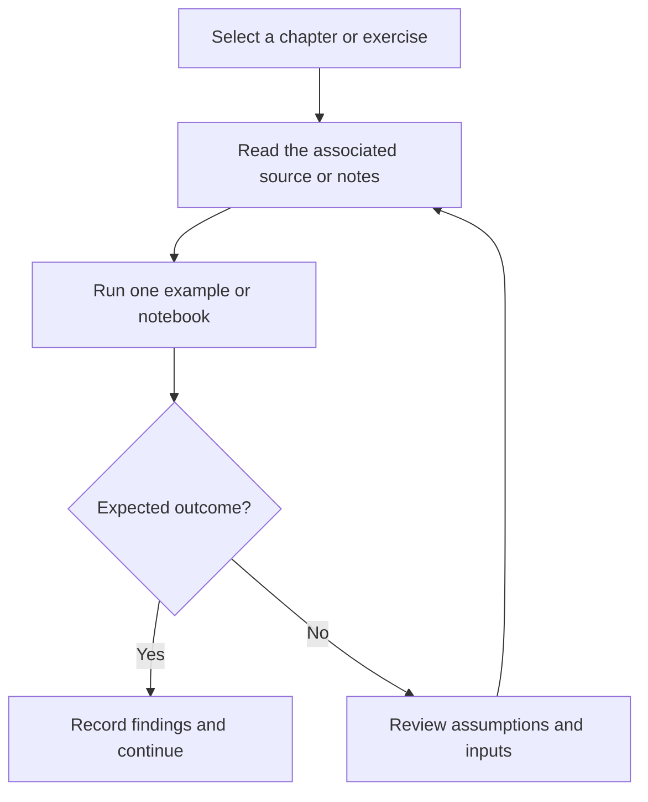

# Dart Programming Fundamentals

Standalone Dart examples for arithmetic, operators, conditionals, and switch statements.

## Project focus

Dart exercises. Use the directory map to choose a focused example or learning topic instead of treating the repository as one application.

## Workflow



## Repository structure

| Path | Purpose |
| --- | --- |
| [`LICENSE`](LICENSE) | Repository licensing terms. |
| [`Opp.dart`](Opp.dart) | Standalone programming exercise or example. |
| [`arthmetic.dart`](arthmetic.dart) | Standalone programming exercise or example. |
| [`else_if.dart`](else_if.dart) | Standalone programming exercise or example. |
| [`ifElse.dart`](ifElse.dart) | Standalone programming exercise or example. |
| [`jake.dart`](jake.dart) | Standalone programming exercise or example. |
| [`list.dart`](list.dart) | Standalone programming exercise or example. |
| [`map.dart`](map.dart) | Standalone programming exercise or example. |
| [`odd_even.dart`](odd_even.dart) | Standalone programming exercise or example. |
| [`operator.dart`](operator.dart) | Standalone programming exercise or example. |
| [`switch_case.dart`](switch_case.dart) | Standalone programming exercise or example. |

## Getting started

```bash
git clone https://github.com/Raimal-Raja/dart.git
cd dart
```

Install the Dart SDK and run an individual exercise.

```bash
dart run Opp.dart
```

## Verification

Compile or run one exercise at a time, test ordinary and boundary inputs, and compare the output with its stated problem. A successful build is not proof of algorithmic correctness.

## Contributing

Include reproduction steps, the affected path, expected behavior, and the checks you ran. Keep credentials, generated environments, and unnecessary build artifacts out of commits.

## License

See [LICENSE](LICENSE) for the repository's license.
